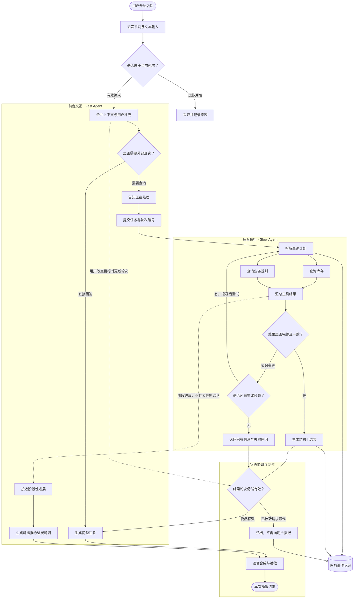
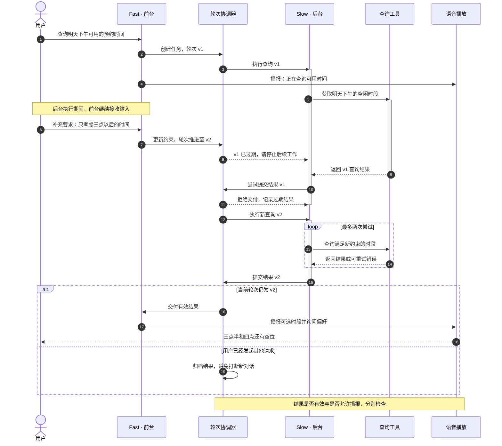

# Mermaid 渲染效果评审

这是虚构的语音助手架构，仅用于检查渲染效果，不代表任何项目已经实现的设计。
图中不指定颜色和字体，统一使用当前 Neovim 的 Mermaid 主题。

## 1. 复杂流程图：并行处理、分组与重试

重点看：分组标题是否清楚、菱形与数据库节点是否协调、长中文标签是否被截断、回路线是否容易追踪。

## 2. 时序图：处理中补充要求与过期结果

重点看：参与者、生命线、激活条、注释、分支区域和虚线返回箭头是否清楚。横向内容较多，可用较宽的窗口查看。

## 检查记录

- [ ] 中文、英文和数字清楚，缩放后仍能阅读。
- [ ] 标签没有遮住节点，文字没有被裁掉。
- [ ] 分组、普通节点、条件节点与数据库节点有可辨识的层次。
- [ ] 复杂连线和重试回路可以追踪。
- [ ] 时序图的注释与分支区域没有刺眼的默认配色。
- [ ] 滚动、切换窗口后，图片不会残留或消失。
